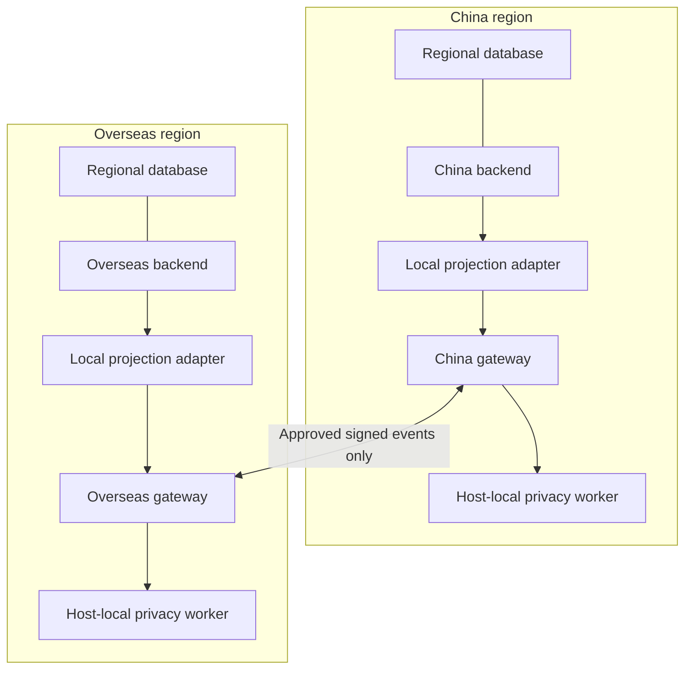

# Regional egress review and deployment boundary

## Who implements the semantic classifier?

SplinterBridge owns the review contract and enforcement before signing. Each
platform owns the regional model deployment, training or model selection,
evaluation, threshold calibration, policy approval, human review, and capacity.
A platform can use an existing locally hosted model; training from scratch is not
required. A maintained model adapter can also be supplied by SplinterBridge in a
future release. Neither a prompt nor a JSON schema establishes classifier quality.

Version 0.6.0 implements an asynchronous review gate and a real host-local gRPC
client. It does **not** ship model weights, an inference server, or a validated
semantic classifier. The synthetic reviewer in `examples/federate.rs` only
recognizes the two exact demonstration strings; never deploy it as moderation.
Without a configured reviewer, preparation fails with `UNCERTAIN_PERSONAL_DATA`.

The semantic review checks candidate text for prohibited personal data. It does
not infer political opinions, religion, health, sexuality, ethnicity, identity,
or other attributes of an account. An approved public display name is not a
verification record. Embedded emails, phones, IPs, devices, precise locations,
identity numbers, credentials, internal IDs or undeclared sensitive inferences
must block the export. If provenance or context is insufficient, mark uncertainty.

The literal route catalog remains a separate mandatory check. A model cannot
approve a keyword match or rewrite the candidate to bypass it. Reducing catalog
false positives requires an explicit locally approved catalog change, not a
model override. Normalization catches some spelling variants, not all evasions.

## Backends stay mutually blind



Only the gateway-to-gateway edge crosses the boundary. It is a deployment
requirement; federation transport is not implemented by this release. Incoming
accepted projections are handed to the receiving region's own adapter. There
is no remote DB lookup, account resolution API, shared identity directory,
replication stream, cross-region join, or shared regional HMAC secret.

A federated pseudonym/resource reference is protocol metadata for indexing an
imported projection. It is not permission or a mechanism to resolve an internal
account in the other backend. Public handles can still identify a person.

Enforce this topology outside the library: default-deny network policies, separate
service identities, separate secrets and storage, gateway-only peer allowlists,
and no domestic DB credentials in the peer-facing gateway or model worker.
The local adapter alone obtains its authorized regional projection. Do not give
a classifier network access to the peer or a cloud fallback. A Unix socket only
proves the immediate connection is local; it cannot stop a malicious worker from
relaying data. Deny worker network egress and audit its deployment.

This architecture supports separation and minimization; it does not establish
whether a particular operator owes fines or complies with any jurisdiction.
See [Legal applicability and deployment requirements](LEGAL_DEPLOYMENT.md) for
source-linked obligations and the separate local authorization process required
before technical route configuration.

## Enforced export sequence

1. Check the configured origin/destination pair and destination-specific opt-in.
2. Project local business fields, derive opaque protocol references, validate
   event shape/size and reject private-account content.
3. Apply literal route rules and local media checks. China rules apply if either
   endpoint is China; global-to-global events do not inherit those rules.
4. Enforce content opt-in and optional profile-field opt-ins for that destination.
5. Acquire a non-queuing capacity permit; send only the candidate `handle`,
   `display_name`, enabled avatar URL and allowed public content to the local model.
6. Require exactly one valid decision per submitted field, no unknown fields,
   and confidence at or above the configured threshold. Missing/duplicate fields,
   invalid scores, timeout, unavailability or saturation hold the whole export.
7. Sign the unchanged approved event only after all checks succeed.

The local original is immutable throughout. Review is per destination. A blocked
China export cannot delete the domestic event or suppress a permitted global route.
The model cannot add fields, rewrite values, select routes or emit free-text errors.

## Integrating the local worker

Implement `SemanticClassifier` in-process with a nonblocking, cancellation-safe
future, or implement `proto/local_review.proto` in a separate local worker. The
provided `UnixGrpcClassifier` is available on Unix platforms and has no public
TCP/DNS constructor. It connects only to an absolute Unix socket path, verifies
the server OS UID on every connection/reconnection, bounds message sizes, and
sets gRPC deadlines. Protect the socket directory and its parent directories.
Never expose this service on the peer-facing federation listener.

A gateway must be configured with both a reviewer and each allowed route:

```rust,ignore
let model = UnixGrpcClassifier::connect(
    std::path::Path::new("/run/splinter/privacy.sock"),
    configured_worker_uid,
    std::time::Duration::from_millis(500),
).await?;
let review = SemanticReviewGate::new(
    &model, 32, std::time::Duration::from_millis(500), calibrated_threshold_bps,
)?;
let gateway = OutboundGateway::new(origin, key_id, &signer, &filter, &safety)?
    .with_route_policy(destination, ExportRoutePolicy {
        allow_content: true,
        profile_options: PublicProfileOptions::default(),
    })
    .with_semantic_review(&review);
let envelope = gateway.prepare_local(destination, &raw, &pepper, &draft).await?;
```

These capacity/deadline numbers illustrate wiring, not measured recommendations.
Share the gate across gateways using the same worker capacity. The worker must
also enforce its own global concurrency cap and cancel work on RPC cancellation.
Client cancellation is not proof that arbitrary GPU/server work stopped.
Do not use `spawn_blocking` or detached inference without a bounded, cancellable
worker design. No retry, fallback-to-allow, cache, or persistence is hidden here.

`ReviewRequest.candidate_json` contains the constant policy code, configured route
codes and the named candidate text fields. It contains no opaque protocol IDs,
raw profile records, credentials, follower graphs or historical account data.
The worker returns `ReviewResponse.report_json` with this closed shape:

```json
{"fields":[{"field":"handle","decision":"ALLOW","confidence_bps":9900},{"field":"display_name","decision":"UNCERTAIN_PERSONAL_DATA","confidence_bps":9900}]}
```

The only decisions are `ALLOW`, `PROHIBITED_PERSONAL_DATA`, and
`UNCERTAIN_PERSONAL_DATA`. All submitted fields require a verdict. Scores must be
integers in 0..10000; calibrate them on representative local evaluation data.
An LLM saying “99% sure” is not calibration. A parser-valid high-confidence answer
can still be wrong. Treat text as untrusted data, give the worker no tools, test
prompt injection and multilingual obfuscation, and measure false-negative and
false-positive rates. Hold languages/content types outside the evaluated scope.
Do not infer protected attributes or emit model rationales or rejected values.

The model sees candidate text inside the origin region before it is approved for
export. It must not log prompts, responses, gRPC bodies or arbitrary error strings.
Provision local review access, deletion/retention and audit rules separately.
Never write candidate values into peer errors or telemetry labels.

## JSON review API

`review_local_json(...).await` uses the same mandatory checks as `prepare_local`.
It returns only the approved business fields and `policy_code`. Opaque protocol
IDs and notices stay in the envelope interface, not this business projection.
Use `policy_notices()` for local UI notices when using the envelope API.

```json
{"policy_code":"MINIMAL_EGRESS_V1","handle":"@example","display_name":"Example","followers_count":42,"is_private":true}
```

Rejections contain only a fixed code, for example `POLICY_KEYWORD`,
`PRIVATE_ACCOUNT`, `PROHIBITED_FIELD`, `UNKNOWN_FIELD`, `ROUTE_NOT_ALLOWED`,
`CONTENT_NOT_ALLOWED`, `INVALID_PROJECTION`, or `MEDIA_POLICY`.
Pending human review contains `UNCERTAIN_PERSONAL_DATA` and a fixed field name,
without its value. For whole-request failures the field is the first unresolved
field, `handle`; the whole event is withheld, not just that field. This response
does not create a persistent human-review ticket. The platform must implement a
region-local review workflow. Re-evaluate the exact event before a later export.

## Requirements for large social backends, still to implement

| Area | Required deployment behavior | Status in this release |
| --- | --- | --- |
| Model inference | Regional model, calibrated thresholds, adversarial multilingual evaluation, bounded worker capacity | Contract/client only; no model supplied |
| Federation transport | Separate gRPC listener, authenticated mTLS peers, certificate rotation, authorization per route/event | Existing wire stubs only |
| Durable dispatch | Local transactional outbox, per-destination approval state, retries with backoff, dead-letter handling | Not implemented |
| Receiver persistence | Local inbox deduplication, replay windows, atomic apply + acknowledgement, idempotent writes | Not implemented |
| Review state | Local retained candidate references, explicit review decisions, recheck on policy/model changes | Not implemented |
| Isolation | No shared DB access, no peer-to-domestic services, no model network egress | Deployment controls required |
| Operations | Key management, config rollout, quotas, aggregate value-free metrics, disaster recovery, policy rollback | Not implemented |
| Capacity | Regional load tests, p50/p95/p99 latency, saturation, failure injection, privacy regression corpus | No production benchmark claim |

A future outbox must store domestic event references locally, review independently
per destination, and send only current approved envelopes. Retries need receiver
idempotency; signatures alone do not prevent replay. Store rejected/pending state
locally and do not send rejected bodies to the peer. Version policy/model changes
and re-review queued work before dispatch where required. Define semantics for
edits, deletion, retention and abuse controls without remote database access.

## Validation and migration

0.6.0 changes `prepare_local` and `prepare` into async APIs. Add `.await`, explicit
route configuration and a semantic review gate. Source callers cannot silently
retain permissive behavior: no routes and no classifier are configured by default.
Advanced `prepare` now enforces sender extras and semantic review too. Media MIME
metadata accepts only the explicit supported type list (or absent metadata);
engagement events cannot carry publication text or media. New error
variants and removal of matched terms/categories from `EgressFilterError` require
call-site updates. No federation field numbers or signature bytes were changed.

`InboundGateway` still independently verifies peer trust, shapes, literal/media
policy, private-account restrictions, optional fields and notices. It does not
prove which origin model ran or consult the origin backend. Origin classifier
execution is enforced before signing, and the receiver trusts a locally provisioned
gateway key. Model/version attestation is not implemented.

Tests cover the route matrix, privacy minimization, optional fields, unchanged
originals, fail-closed model responses, concurrency, timeout cleanup, and bounded
gRPC exchanges over in-memory I/O. The OS Unix-socket/UID integration test is
explicitly run by Linux CI with `cargo test --workspace --locked -- --ignored`.
The authoring environment blocks Unix socket creation, so that test could not be
validated there. See VALIDATION.txt for actual commands and results.

Transport implementation follows Tonic's custom-connector pattern; dependency
behavior was checked against the pinned 0.12.3 source and the official
[custom transport example](https://github.com/grpc/grpc-rust/blob/master/examples/src/mock/mock.rs).
